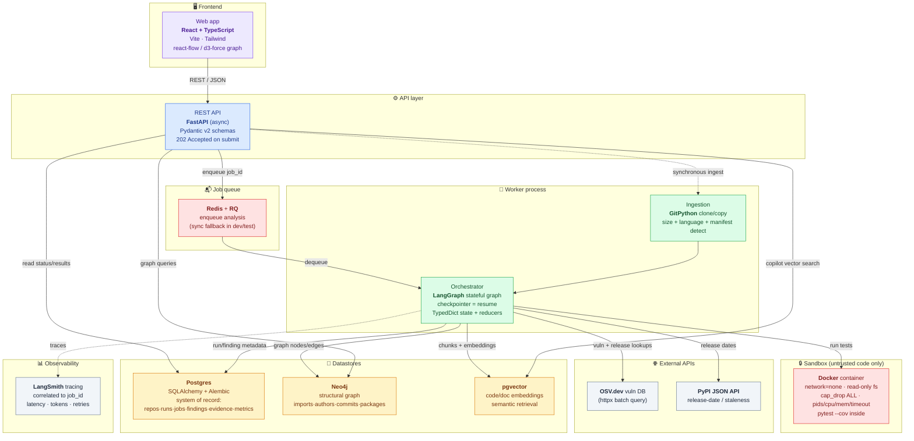
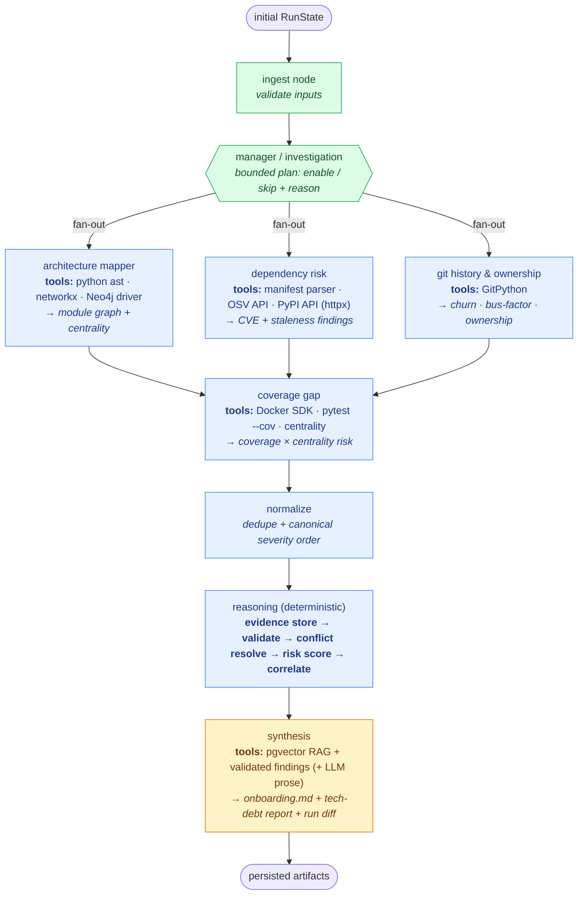
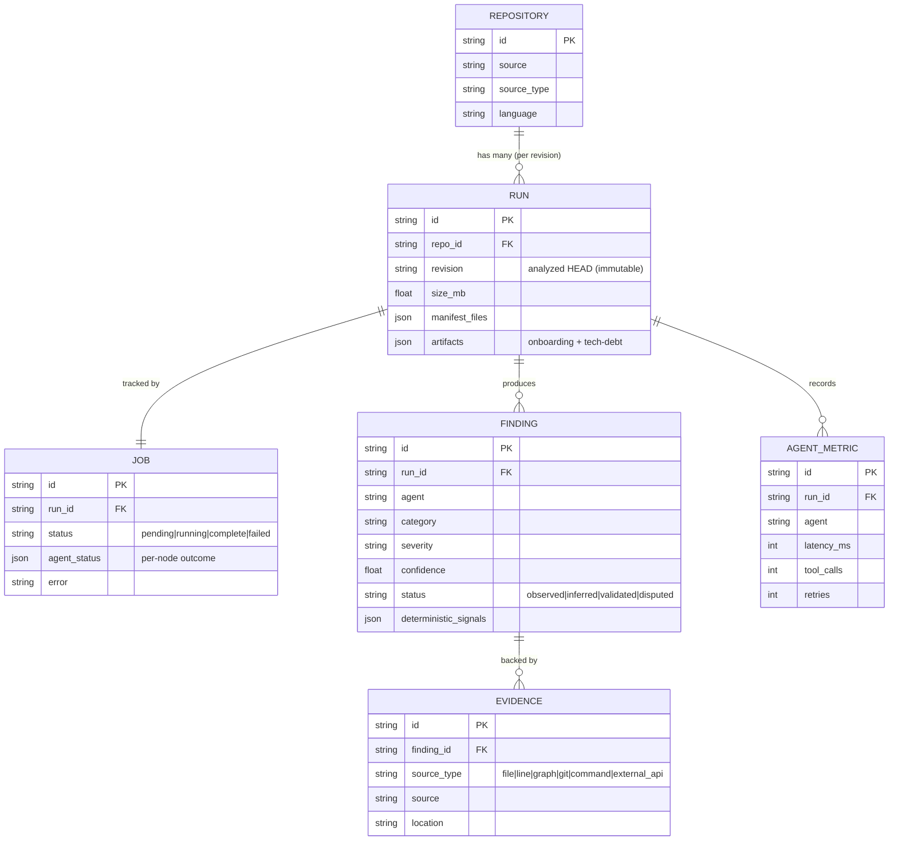
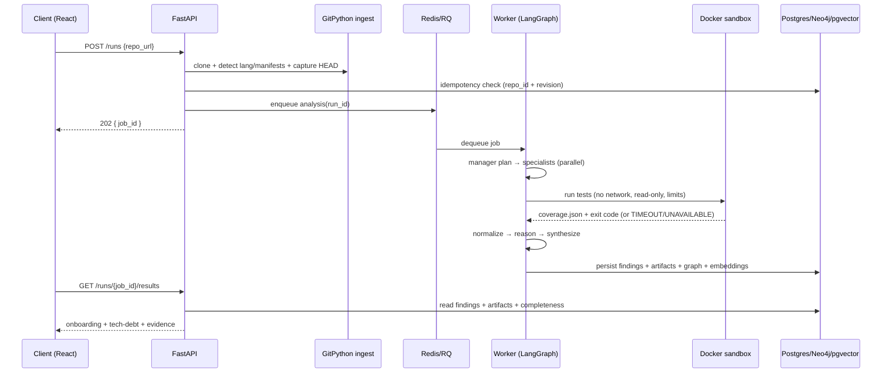

# RepoSage — Architecture Diagram

Technology is labelled at every component. Three views:
1. **System architecture** — client → API → queue → worker → stores, with the tech at each box.
2. **Agent pipeline (worker internals)** — the LangGraph nodes and the tools each uses.
3. **Data model** — the core persistence relationships.

---

## 1. System architecture (tech at each component)

---

## 2. Agent pipeline — nodes & tools (worker internals)

**Legend:** Blue = deterministic (zero LLM tokens) · Amber = LLM-capable · Green = control/IO.
Every node runs through `run_node(...)` → emits status + latency + tool_calls + retries + errors, retries transient failures (bounded), and never aborts the run on a single node failure.

---

## 3. Data model (persistence)

> Postgres is the system of record for everything above. Neo4j separately holds the structural graph (modules/imports/authors/commits/packages) keyed by revision; pgvector holds code/doc embeddings. The rule is one authoritative home per fact — no cross-store duplication without a retrieval reason.

---

## 4. Request lifecycle (sequence)

