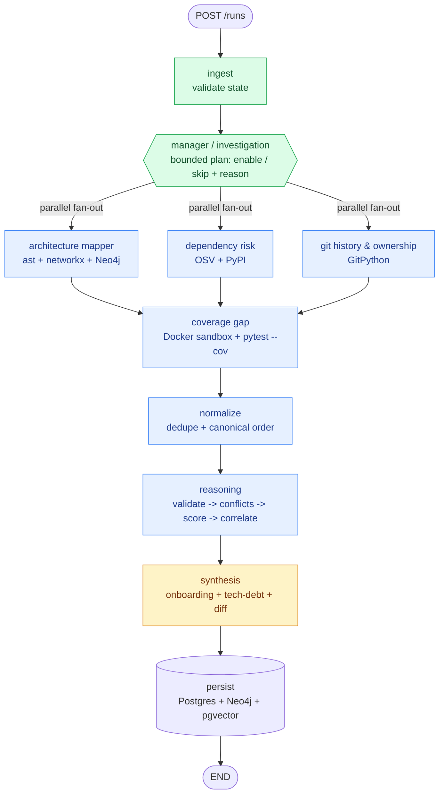
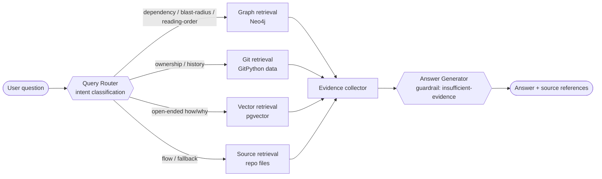

# RepoSage — Interview Guide

> A multi-agent system that ingests a Git repository and produces two living artifacts: an **onboarding guide** (architecture map, suggested reading order, ownership) and a **tech-debt report** (dependency risk, test-coverage gaps on high-centrality code, bus-factor risk). Re-running analysis keeps both artifacts current as the codebase changes.

This document is written to be read before a technical interview. It covers the elevator pitch, architecture, tech choices and the reasoning behind them, the end-to-end flow, the agent architecture and tools, fallbacks, and the questions an interviewer is likely to ask.

---

## 1. "Tell me about the project" (≈2 minutes, spoken)

> RepoSage is a multi-agent codebase onboarding and tech-debt copilot. You point it at a Python Git repository and it produces two things that stay current as the code evolves: an onboarding guide and a prioritized tech-debt report. On top of that there's an interactive copilot you can ask things like "what depends on this module?" or "who has historically worked on this?" and get evidence-backed answers.
>
> The core design principle is that it's **evidence-driven, not prompt-driven**. Most systems like this throw the whole repo at an LLM and hope. RepoSage instead runs deterministic analyzers first — an AST import-graph builder, an OSV vulnerability lookup, a git-history miner, and a sandboxed coverage runner. Those produce hard facts. Specialist agents turn those facts into structured `Finding` objects, each carrying `Evidence` with provenance back to a file, a graph edge, a commit, or an external API result. Then an evidence-validation stage checks the important conclusions, a conflict resolver handles contradictions, a deterministic scorer ranks the tech debt, and synthesis assembles the final onboarding and tech-debt artifacts — every claim either trace-linked to a finding or explicitly labeled an inference.
>
> I'd be upfront about one thing: it's **deterministic-first and LLM-optional**. Right now the whole pipeline — including synthesis and the copilot — runs with no LLM and no API key; it produces structured, provenance-backed output. The "agentic AI" is the orchestration itself: a planning manager agent, parallel specialists, bounded retries, checkpoint/resume, evidence validation and conflict resolution — plus classical AI like PageRank centrality and graph-traversal reasoning. The LLM is deliberately a *decoupled rendering seam* — clean `(answer, sources)` and structured-artifact contracts are already in place so a model can render validated evidence into fluent prose without ever becoming the source of truth. That separation is a feature: it keeps the system reproducible, auditable, hallucination-free, and fully testable offline.
>
> It's orchestrated with **LangGraph** as a stateful, resumable graph. A manager agent decides which specialists apply to a given repo — skip dependency analysis if there's no manifest, skip coverage if there are no tests — and the independent specialists fan out in parallel. Every node records status, latency, retries, and errors, so if one specialist fails the run still completes with the rest plus an explicit note of what's missing.
>
> The thing I'm most careful about is **safety**: repository code is untrusted, so it only ever executes inside a Docker sandbox with no network, a read-only filesystem, dropped Linux capabilities, and CPU/memory/time limits. That boundary is covered by an automated isolation test.
>
> Stack is FastAPI + a Redis/RQ worker on the backend, Postgres as the system of record, Neo4j for the relationship graph, and pgvector for semantic retrieval. Frontend is React/TypeScript/Vite. There's also an evaluation harness that compares a deterministic-only baseline against the full agentic pipeline so I can show the orchestration actually improves outcomes rather than just adding complexity.

**One-liner if they want it shorter:** "It's an evidence-first, multi-agent system that reads a repo with deterministic analyzers, turns facts into validated findings through a LangGraph agent pipeline, and synthesizes an onboarding guide + tech-debt report — with every claim traceable to evidence and all untrusted code executed in a locked-down sandbox."

---

## 2. Problem & motivation

Joining an unfamiliar codebase is slow and risky. The questions a new engineer or a maintainer actually has are:

- What should I read first? How is this structured?
- If I change module X, what breaks? (blast radius)
- Who historically owns this area? Where's the bus-factor risk?
- Which dependencies are vulnerable or abandoned?
- Which *important* modules are under-tested?

Static-analysis scripts answer fragments of this as one-off reports. RepoSage's differentiators:

1. **Living artifacts** — re-running updates the onboarding + tech-debt docs and diffs against the previous run (new / changed / resolved findings).
2. **Evidence-first** — every recommendation is explainable from repository evidence, not unsupported LLM output.
3. **Engineering-impact ranking** — tech debt is ranked by combined signals (centrality × coverage × churn × dependency severity × bus-factor), not by raw warning counts.

---

> 📐 Full visual diagrams (system architecture with tech per component, agent pipeline, data model, request sequence) live in **[ARCHITECTURE.md](./ARCHITECTURE.md)**. A one-page day-of summary is in **[CHEATSHEET.md](./CHEATSHEET.md)**.

## 3. High-level architecture

```text
Client (React / TS / Vite / Tailwind)
      |  REST
      v
FastAPI  (submit / status / results / graph / findings / query / history)
      |
      v
Job Queue (Redis + RQ)  ───────────────►  Worker process
                                              |
                                              v
                                    LangGraph Orchestrator (stateful, resumable)
                                              |
                              ┌───────────────┴───────────────┐
                              |   Manager / Investigation Agent |
                              └───────────────┬───────────────┘
                                              | fan-out (parallel)
                   ┌───────────────┬──────────┴──────────┬───────────────┐
                   v               v                     v                v
            Architecture      Dependency Risk       Git History &     (coverage runs
              Mapper             Agent               Ownership         after specialists)
                   └───────────────┴──────────┬──────────┴───────────────┘
                                              v
                                   Finding Normalizer (dedupe + canonical order)
                                              v
                                   Coverage Gap Agent (SANDBOXED; uses centrality)
                                              v
                             Reasoning: validate → resolve conflicts → score → correlate
                                              v
                                   Synthesis Agent (onboarding + tech-debt)
                                              v
                              Persist: Postgres (SoR) + Neo4j (graph) + pgvector (RAG)
```

### Agent graph (LangGraph) — rendered



> Blue = deterministic (no LLM tokens) · Amber = LLM-capable · Green = control/IO. Every node also emits status + latency + retries + errors, and append-only channels merge via reducers so a failed specialist never discards the others' results.

### Copilot query-time sub-graph



### Datastores and their jobs
| Store | Role | Why |
|---|---|---|
| **Postgres** | System of record: repos, runs, jobs, findings, evidence, metrics, eval results | Relational integrity, transactional job/run state, revision history |
| **Neo4j** | Structural knowledge graph (modules, imports, authors, commits, packages) | Native graph traversals for dependency / blast-radius / centrality queries |
| **pgvector** | Semantic embeddings of code + doc chunks and generated artifacts | Vector similarity for open-ended copilot questions |
| **Redis** | Job queue (RQ) + transient coordination | Decouples the fast API submit from long-running analysis |
| **Working dir** | Immutable per-run repo snapshot | Every finding traces to the analyzed revision |

> Design rule: avoid duplicating the same fact across stores. Postgres owns run/finding metadata, Neo4j owns relationships, pgvector owns semantic retrieval.

---

## 4. Tech stack and *why*

| Area | Choice | Why this one |
|---|---|---|
| Orchestration | **LangGraph** | Needed a *stateful, resumable* graph with explicit nodes/edges, parallel fan-out, and checkpointing. A linear chain or a single mega-prompt can't express conditional skipping, partial-failure isolation, and resume-from-checkpoint. |
| API | **FastAPI** | Async, Pydantic-native request/response validation, OpenAPI for free. The submit endpoint returns `202 Accepted` immediately. |
| Job queue | **Redis + RQ** | Analysis is long-running (clone + AST + git mining + sandbox). The API must not block. RQ is simpler than Celery for this scope; a synchronous in-process fallback runs in dev/tests. |
| State models | **Pydantic v2** | Strong typing + validation for `Finding`/`Evidence`; validation rules (e.g. high-severity finding *must* carry evidence) are enforced at the model layer. |
| Relational DB | **Postgres (SQLAlchemy + Alembic)** | System of record; migrations; `pgvector` extension lives in the same engine. |
| Graph DB | **Neo4j** | The architecture graph is a *first-class query surface*, not just a viz backend — transitive dependency / blast-radius queries are natural in Cypher. |
| Vector search | **pgvector** | Keeps embeddings in Postgres instead of adding another datastore; good enough for repo-scale RAG. |
| AST parsing | **Python `ast`** | v1 is Python-only; the stdlib AST is reliable and dependency-free. (tree-sitter is the documented v2 multi-language path.) |
| Graph metrics | **networkx** | In-degree / PageRank centrality over the import edge list without reinventing graph algorithms. |
| Git mining | **GitPython** | Commit log, authorship, churn, windowed to a configurable recency. |
| Vuln data | **OSV.dev API** (via `httpx`) | Free, authoritative, batch query endpoint; `PyPI` JSON API for release-date staleness. |
| Sandbox | **Docker SDK** | The security boundary for executing untrusted test suites. |
| Observability | **LangSmith** | Traces correlated to `job_id` + node identifiers; per-node latency / tokens / retries. |
| Frontend | **React + TypeScript + Vite + Tailwind** | Fast dev loop; `react-flow`/`d3-force` for the interactive graph explorer. |

---

## 5. The agent architecture (the part interviewers dig into)

### 5.1 What *kind* of agent system is this?

It is a **bounded, orchestrated multi-agent system built on a directed state graph** — deliberately **not** an open-ended autonomous planner. The important nuance to articulate:

- The **Manager / Investigation Agent** chooses from a *fixed, enumerated set* of supported workflows (`architecture`, `dependency`, `git_history`, `coverage`). It decides enable/skip + a reason. It cannot invent arbitrary new workflows. That keeps routing **auditable and reproducible**.
- **Not every node is an LLM.** Deterministic analyzers stay deterministic (AST, OSV, git, coverage). LLM reasoning is reserved for interpretation, prioritization explanation, validation, and synthesis prose. This controls cost and keeps the facts reliable.
- The graph is **stateful and resumable**: shared state is a `TypedDict` with reducers; append-only collections (findings, metrics, errors, conflicts) use `operator.add` so parallel nodes merge cleanly without clobbering each other.

If asked to name the pattern: *"manager/orchestrator-worker with deterministic tool nodes, structured hand-off via a shared typed state, and a validate-then-synthesize reasoning tail."*

### 5.2 Shared state (`RunState`)

A `TypedDict` carrying identity (`run_id`, `repo_id`, `revision`, …), the manager `plan`, single-writer analyzer outputs (`architecture`, `dependency_report`, `ownership_report`, `coverage`), and **append-only reducer channels**:

```python
findings:      Annotated[list[Finding], operator.add]
agent_metrics: Annotated[list[AgentMetricRecord], operator.add]
errors:        Annotated[list[dict], operator.add]
conflicts:     Annotated[list[dict], operator.add]
node_status:   Annotated[dict[str, str], _merge_status]   # per-node outcome
artifacts:     dict                                       # synthesis output
```

Why reducers matter: three specialists run in parallel and all append findings. With plain assignment the last writer would win; with `operator.add` their outputs concatenate. That's also what preserves partial state when one specialist fails.

### 5.3 The agents / nodes and their tools

| Node | Type | Tools | Output |
|---|---|---|---|
| **Manager / Investigation** | Decision | repo metadata, config, objective | `{enabled: [...], skipped: {name: reason}, emphasis: [...]}` |
| **Architecture Mapper** | Deterministic | Python `ast`, `networkx`, Neo4j driver | module graph + centrality + provenance; `high_centrality` findings |
| **Dependency Risk** | Deterministic + external | manifest parser, **OSV** API, **PyPI** JSON API | CVE + staleness findings with external-source provenance |
| **Git History & Ownership** | Deterministic | **GitPython** | churn, primary-contributor, bus-factor findings |
| **Finding Normalizer** | Deterministic | schema validation | dedupe by `(agent, category, title)`, canonical severity ordering |
| **Coverage Gap** | Deterministic (sandboxed) | **Docker SDK**, `pytest --cov`, architecture centrality | coverage × centrality cross-reference → `coverage_gap` findings |
| **Reasoning** | Deterministic | evidence store, validator, conflict resolver, risk scorer, correlator | validated/disputed statuses, preserved conflicts, scored & correlated tech debt |
| **Synthesis** | LLM-capable | RAG over pgvector + validated findings | `onboarding` + `tech_debt_report` artifacts, run diff |

**Copilot (query-time) sub-system** has its own mini-graph:

| Component | Role |
|---|---|
| **Query Router** | Classifies the question's intent (dependency / blast-radius / ownership / risk / reading-order / flow / semantic) and picks sources. Deterministic keyword/pattern routing — *not* always vector-RAG. |
| **Retrieval layer** | Graph (Neo4j), Vector (pgvector), Git history, Source files — chosen per intent. |
| **Answer Generator** | Assembles an evidence-backed answer. **Guardrail:** if no evidence was retrieved for a question that needs it, it returns an explicit "insufficient evidence" response instead of fabricating. |
| **Session state** | Short-term conversation memory for follow-ups. |

### 5.4 Node execution contract (reliability built into every node)

Each specialist body is wrapped by `run_node(...)` which provides:

- **Timing + metrics**: `started_at`, `ended_at`, `latency_ms`, `tool_calls`, `retries`, `llm_tokens`.
- **Bounded retries**: `TransientToolError` is retried up to `max_attempts` (default 3); non-transient errors are not retried.
- **Never raises for a node failure** — it records `FAILED` + an error entry and lets the run continue. This is what guarantees partial-failure isolation.
- **Explicit outcome states** (not just pass/fail): `COMPLETE`, `NO_FINDING`, `SKIPPED`, `NOT_APPLICABLE`, `FAILED`.

---

## 6. End-to-end flow (what happens on `POST /runs`)

1. **Submit** — `POST /runs {repo_url | repo_path}`. Ingestion runs *synchronously* inside the request (it's fast): clone/copy into an isolated per-run working dir, enforce the size limit, detect language + manifests, capture HEAD revision.
2. **Idempotency check** — if a *completed* run already exists for the same `repo_id` + revision and `force` is false, return that run instead of re-analyzing (revision-aware idempotency).
3. **Enqueue** — a `job` row is created; analysis is enqueued to Redis/RQ (or runs inline in dev/tests). API returns `202` with a `job_id` immediately.
4. **Worker picks up the job** and invokes the LangGraph workflow with the initial `RunState`.
5. **ingest node** validates required inputs are present in state.
6. **manager node** builds the investigation plan (enable/skip + reasons).
7. **Fan-out** — `architecture`, `dependency`, `git_history` run in parallel; each self-skips if the manager disabled it. Their findings merge via reducers.
8. **coverage node** runs *after* the specialists (it needs architecture centrality for the coverage × centrality cross-reference), inside the Docker sandbox.
9. **normalize node** dedupes findings and assigns canonical ordering.
10. **reason node** runs evidence validation → conflict resolution → risk scoring → correlation (all deterministic, no LLM).
11. **synthesis node** assembles the onboarding guide and tech-debt report; every claim carries a `claim_type` (`observed` vs `inferred`) and tech-debt items carry per-finding attribution.
12. **Persist** to Postgres + Neo4j + pgvector, keyed by revision (previous runs are preserved for diffing).
13. **Consume** — `GET /runs/{id}/status | results | graph | findings/{fid}`, `POST /runs/{id}/query`, `GET /repos/{id}/history`.

---

## 7. Fallbacks & graceful degradation (a recurring interview theme)

The system is built so a missing input or a flaky external service **degrades with an explicit reason** rather than failing the whole run or silently producing a clean-looking result.

| Scenario | Behavior |
|---|---|
| **No manifest** (`requirements.txt`/`pyproject.toml`) | Manager marks `dependency` **skipped** with reason; rest of the run proceeds. |
| **No tests discoverable** | Manager marks `coverage` **skipped**; coverage reported as skipped-with-reason, *not* as 0%. |
| **No `.git` history** | `git_history` **skipped** with reason. |
| **OSV API unreachable** | `OSVUnavailableError` → that portion is marked **"unavailable"** (distinct from "no vulnerability found"). The run does not fail. |
| **Docker unavailable** | `get_sandbox_runner` returns an `UnavailableSandboxRunner` (never the local runner by default) so untrusted code is **never executed unsandboxed**; coverage is reported `UNAVAILABLE`. |
| **Sandbox timeout** | Container is killed, status recorded as `TIMEOUT`, container destroyed. |
| **Unparsable source file** | Logged as unparsed, parsing **continues** (one bad file never aborts the graph). |
| **A specialist throws** | Node recorded `FAILED` + error; other specialists' results preserved; synthesis proceeds with a note of what's missing. |
| **Transient tool error** | Bounded retries (default 3) before marking failed. |
| **Interrupted run** | LangGraph checkpointer resumes from the last completed node without re-running finished work. |
| **Copilot has no evidence** | Answer Generator returns explicit "insufficient evidence" instead of hallucinating. |
| **Non-Python repo** | Rejected at ingestion with a clear "v1 supports Python only" message. |
| **Oversized repo** | Rejected at ingestion before any analysis. |

**Key invariant repeated throughout:** *unavailable ≠ clean, and inferred ≠ observed.* The system never represents missing data as a positive clean result, and synthesized prose is labeled when it's an inference.

---

## 8. The evidence model (why outputs are trustworthy)

```python
class Evidence:
    source_type: Literal["file","line","graph","git","command","external_api"]
    source: str; location: str | None; excerpt: str | None; metadata: dict

class Finding:
    id, agent, category, title
    severity: Literal["critical","high","medium","low","info"]
    confidence: float
    description, affected_components: list[str]
    evidence: list[Evidence]
    recommendation: str | None
    deterministic_signals: dict
    status: Literal["observed","inferred","validated","disputed"]
```

Rules enforced at the model and reasoning layers:
- Deterministic analyzers provide **facts/signals**; agents provide **interpretation/recommendations**.
- Any finding with a severity or recommendation must carry **≥1 evidence reference** unless explicitly marked an inference.
- High-severity findings pass **evidence validation** before they're treated as `validated`; ones that can't be substantiated become `disputed`.
- Final synthesis can only state claims traceable to findings/evidence or clearly labeled inference.

### Tech-debt prioritization
Deterministic signals — `centrality`, `change_frequency`, `lines_changed`, `coverage`, `dependency_severity`, `bus_factor_concentration` — are normalized into a reproducible score. The **LLM never invents the score**; it only explains the engineering implication, correlates related findings, and proposes remediation. Correlated observations on the same component are grouped to avoid double-counting.

---

## 9. Sandboxing (the security story)

Test execution is the only step that runs arbitrary repository code, so it gets the strictest isolation. The flags live in **one place** (`isolation_run_kwargs`) consumed by both the runner and the isolation test, so the security boundary can't silently drift:

- `network_disabled=True` + `network_mode="none"` — no outbound network.
- `read_only=True` — read-only container filesystem; repo mounted **read-only**, with an isolated writable scratch tmpfs for artifacts only.
- `cap_drop=["ALL"]` + `security_opt=["no-new-privileges"]` — minimal Linux capabilities, no privilege escalation.
- CPU (`nano_cpus`), memory (`mem_limit`), process-count (`pids_limit`) and wall-clock timeout limits.
- No host environment/secrets passed in; non-root user inside the image.
- Container is **always destroyed** after success, failure, or timeout.

This is backed by an automated isolation test (`tests/test_sandbox_isolation.py`) that runs a network probe under the *real* isolation flags and asserts `NETWORK_BLOCKED`, plus a Docker-free contract test that fails if anyone weakens the flag set. A `scripts/validate_pipeline.py` harness runs the live assertion + full pipeline against real repos on a Docker host.

---

## 10. Observability, cost & performance

- LangSmith traces correlated to `job_id` and node identifiers.
- Per-node metrics: latency, LLM tokens, tool calls, retries, errors, status.
- Clear separation of deterministic stages (zero LLM tokens) from LLM-reasoning stages.
- Configurable limits (env-driven, `REPOSAGE_` prefix): repo size, git-history window, recent-activity window, bus-factor/coverage/staleness thresholds, sandbox CPU/memory/pids/timeout, LLM budget per run.

---

## 11. Evaluation (proving the agentic pipeline earns its complexity)

A fixed offline evaluation suite builds small deterministic git fixtures with known architecture, ownership, and dependency characteristics, then measures:

- architecture relationship accuracy (precision/recall/F1), blast-radius accuracy
- ownership/churn accuracy, dependency/coverage finding detection
- evidence attribution accuracy, onboarding Q&A correctness
- **unsupported-claim / hallucination rate**

Crucially it computes a **deterministic-only baseline** and compares it to the full agentic + evidence-backed pipeline, so I can demonstrate the orchestration improves useful outcomes (validation, correlation, ranking, evidence-backed Q&A) **without degrading** the deterministic extraction accuracy. Results are persisted (`eval_results.json`) for regression tracking.

---

## 12. API surface

| Method & path | Purpose |
|---|---|
| `POST /runs` | Submit a repo → `202` + `job_id` |
| `GET /runs/{id}/status` | Overall + per-agent status/metrics |
| `GET /runs/{id}/results` | Findings + artifacts + analysis completeness |
| `GET /runs/{id}/graph` | Frontend-friendly architecture graph (explicitly reports availability) |
| `GET /runs/{id}/findings/{finding_id}` | A finding + its evidence + contributing signals |
| `POST /runs/{id}/query` | Interactive copilot question → evidence-backed answer |
| `GET /repos/{id}/history` | Prior runs for diffing |

Status endpoints explicitly expose `incomplete`, `failed`, and `skipped` sets so clients can distinguish a clean result from an incomplete one.

---

## 13. Frontend views

1. **Overview** — run health, revision, analysis completeness.
2. **Graph explorer** — interactive dependency graph (`react-flow`/`d3-force`); click a node for centrality, coverage, ownership, dependencies, risk.
3. **Tech-debt report** — sortable/filterable table with contributing signals.
4. **Finding detail** — severity, confidence, evidence, source locations, related findings.
5. **Agent trace** — per-agent status, latency, retries, tool calls, raw structured output.
6. **Copilot** — natural-language questions with source/evidence references.

---

## 14. Likely interview questions & crisp answers

**Q: Why multi-agent instead of one big LLM prompt?**
Each specialist has a different tool surface and failure mode (AST parser vs. OSV API vs. git miner vs. sandboxed test runner). Splitting them lets independent analyses run in parallel, keeps deterministic work deterministic (cheap + reliable), isolates failures, and makes every stage individually observable. A single prompt couldn't do conditional skipping, partial-failure isolation, or resume-from-checkpoint.

**Q: How do you stop the LLM from hallucinating?**
Three layers: (1) findings must carry evidence with provenance or be explicitly marked inference; (2) an evidence-validation stage disputes high-severity findings it can't substantiate; (3) synthesis and the copilot answer generator can only use retrieved/validated evidence — the copilot returns "insufficient evidence" rather than guessing. The risk score is computed deterministically; the LLM only explains it.

**Q: What's the state model and how do parallel nodes not clobber each other?**
`RunState` is a `TypedDict`. Append-only channels (findings, metrics, errors, conflicts) use `operator.add` reducers so parallel writes concatenate; single-writer analyzer outputs use last-write-wins. That's also what preserves partial results on failure.

**Q: How does resume work?**
LangGraph is compiled with a checkpointer. State is persisted after each node; resuming a thread replays from the last checkpoint without re-running completed nodes.

**Q: How do you keep untrusted repo code safe?**
It only ever runs in a Docker sandbox: no network, read-only fs, dropped capabilities, no-new-privileges, resource + time limits, destroyed after use. If Docker is unavailable the system refuses to run code locally and reports coverage unavailable. There's an automated test that proves the network is blocked.

**Q: How is "re-running keeps it current" implemented?**
Each run is a new row linked to the same `repo_id` + revision; previous runs are retained. Synthesis diffs the new tech-debt report against the prior run (new / changed / resolved). Idempotency: resubmitting the same revision returns the existing completed run unless forced.

**Q: What's deterministic vs. LLM?**
Deterministic: ingestion, AST graph + centrality, OSV/PyPI lookups, git mining, coverage, normalization, validation, conflict resolution, risk scoring, correlation, query routing, synthesis assembly, and copilot answering. LLM-capable (optional seam, not currently wired): rendering the structured synthesis + copilot output into fluent prose — always constrained to provided evidence.

**Q: If there's no LLM call, how is this an AI project?**
"AI" is broader than "calls an LLM," and two kinds of AI are doing the work here. First, **agentic orchestration**: a manager agent plans which specialists apply, specialists run in parallel, and a reasoning tail validates evidence, resolves conflicts, correlates, and scores — with bounded retries and checkpoint/resume. That autonomous, stateful control flow *is* the agentic system. Second, **classical AI / IR**: PageRank-style centrality, graph-traversal reasoning for dependencies and blast radius, churn/ownership inference, and vector-similarity retrieval. The design is deliberately deterministic-first so repository facts are reproducible and never hallucinated; the LLM is a decoupled rendering layer that's architected (clean contracts, embeddings-provider abstraction, token budget, LangSmith hooks) but intentionally optional. Framed honestly: *evidence-first, LLM-optional agentic system — the deterministic core is the product; generative AI is a presentation seam that can never be the source of truth.*

**Q: Then how does the copilot "analyze" a repo without an LLM?**
It doesn't re-analyze per question — the heavy analysis already produced an import graph with centrality, an ownership report, and embedded code chunks. Each question runs the same `route → retrieve → format` shape as LLM RAG, but every slot is deterministic: a keyword/pattern router picks the intent and target module; the matching retriever answers it — graph questions ("what depends on X", blast radius) are *computed* via graph traversal/reachability, ownership from the mined report, open-ended questions by vector cosine similarity, source by reading file lines; then a template renders the result and attaches each retriever's `Evidence`, or returns "insufficient evidence" if nothing matched. For structured questions this is *more* reliable than an LLM because answers are computed, not generated. Trade-off: answers are accurate and cited but templated rather than conversational, and offline free-text relevance uses a deterministic hashing embedder — which is exactly where an optional LLM/real-embeddings layer would add the most value.

**Q: Biggest limitations / what would you do next?**
v1 is Python-only (AST is stdlib-reliable); multi-language via tree-sitter is the documented v2 path. Other v2 items: GitHub Action / PR-comment integration, scheduled re-analysis, and autonomous remediation/PR generation. Blast radius is an *approximation* from the static import graph — dynamic imports aren't fully resolvable, which is why unparsable/dynamic cases are logged and surfaced honestly rather than hidden.

**Q: How do you know the agents add value and aren't just complexity?**
The evaluation suite runs a deterministic-only baseline against the full pipeline on the same fixtures and tracks precision/recall, attribution accuracy, Q&A correctness, and hallucination rate — so the improvement (and the preserved deterministic accuracy) is measurable and regression-tracked.

---

## 15. 30-second summary to close on

RepoSage reads a repository the way a careful senior engineer would: gather hard facts first, turn them into claims only when there's evidence, validate the important ones, rank by real engineering impact, and only then write it up — all while treating the repo's own code as untrusted and running it only in a locked-down sandbox. The multi-agent LangGraph design makes that process parallel, resumable, observable, and honest about what it doesn't know.
